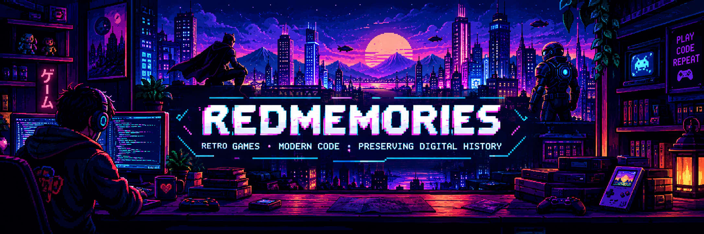

 <!--
  REDMEMORIES PROFILE README
  Upload the banner image to this repository as:
  assets/redmemories-banner.png
-->

<div align="center">
  

  <br/>

  

  <br/>

  **`PLAYER 1` · `DEVELOPER` · `GAME PRESERVATION`**

  *Some games deserve a second life.*

  <br/>

  [](https://github.com/RedMemories)
  [](https://ko-fi.com/redmemories_ita)
</div>

---

## `> WHOAMI`

```text
PLAYER      : RedMemories
CLASS       : Developer / Game Preservation
MISSION     : Give forgotten games a second life
SPECIALTY   : Reviving classic mobile games
STATUS      : Building the next level...
```

I'm passionate about technology, classic games, and keeping digital experiences alive.

My projects focus on bringing older mobile games back to modern devices, working around legacy technology and making these experiences accessible again.

I believe great games deserve to be remembered — and sometimes, to be played again.

## `> FEATURED PROJECTS`

<table>
  <tr>
    <td width="50%" valign="top">
      <h3>🕷️ The Amazing Spider-Man Revived</h3>
      <p>Bringing the classic mobile Spider-Man experience back to modern Android devices.</p>
      <a href="https://github.com/RedMemories/TheAmazingSpidermanRevived">
        
      </a>
    </td>
    <td width="50%" valign="top">
      <h3>🦇 The Dark Knight Rises Revived</h3>
      <p>A preservation project giving the classic Gotham mobile game a new lease on life.</p>
      <a href="https://github.com/RedMemories/TheDarkKnightRisesRevived">
        
      </a>
    </td>
  </tr>
  <tr>
    <td width="50%" valign="top">
      <h3>🚀 Mass Effect Infiltrator Revived</h3>
      <p>Preserving a classic sci-fi action game and adapting it for modern hardware.</p>
      <a href="https://github.com/RedMemories/MassEffectInfiltratorRevived">
        
      </a>
    </td>
    <td width="50%" valign="top">
      <h3>🕸️ More Spider-Man projects</h3>
      <p>Exploring more of the classic mobile Spider-Man catalogue through preservation work.</p>
      <a href="https://github.com/RedMemories/TheAmazingSpiderman2Revived">
        
      </a>
      <br/>
      <a href="https://github.com/RedMemories/SpiderManTotalMayhem">
        
      </a>
    </td>
  </tr>
</table>

## `> PLAYER STATS`

<div align="center">
  
  
</div>

<div align="center">
  
</div>

## `> CURRENT QUEST`

- [x] Bring classic mobile gaming projects back to life
- [x] Explore ways to make legacy games work on modern hardware
- [ ] Keep improving, experimenting, and preserving gaming history
- [ ] Start the next quest

## `> SUPPORT THE MISSION`

If you enjoy my work, consider starring a repository or supporting future projects.

<div align="center">
  <a href="https://ko-fi.com/redmemories_ita">
    
  </a>

  <br/><br/>

  **Thanks for visiting my profile.**

  `PRESS START TO CONTINUE`

  <sub>Made with nostalgia, curiosity, and a little bit of code.</sub>
</div>
